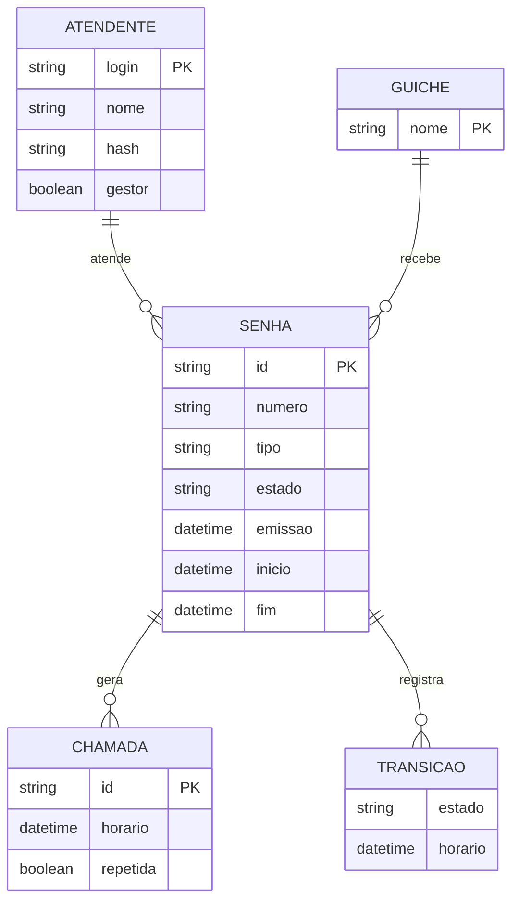

# Modelo lógico de entidades

Modelo conceitual: no protótipo as entidades são persistidas como documento JSON transacional em SQLite (tabela state). Em uma migração para MySQL, normalizar em tabelas com chaves estrangeiras e índice único em dia/tipo/sequência.
