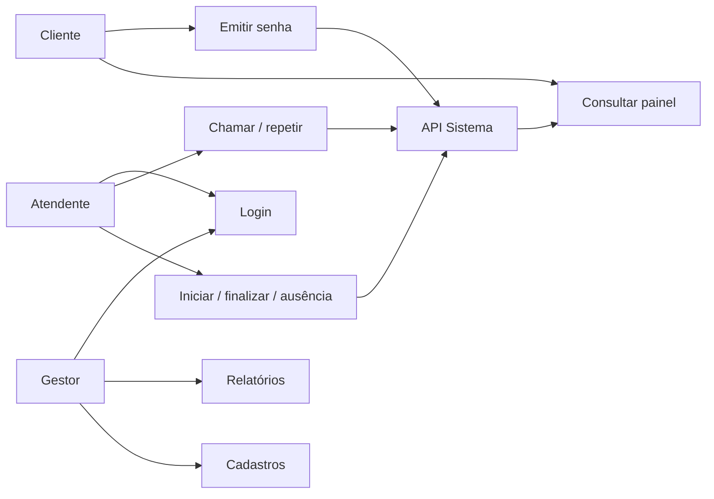
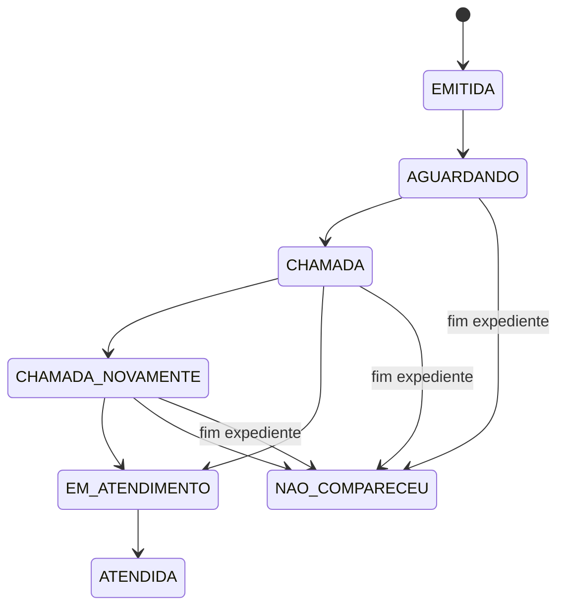

# Casos de uso e máquina de estados

Caso de uso chamar: atendente autenticado seleciona guichê livre; sistema verifica expediente e fila, escolhe senha em transação, registra atendente e horário e atualiza painel. Alternativas: fila vazia, guichê ocupado, falha de conexão.
